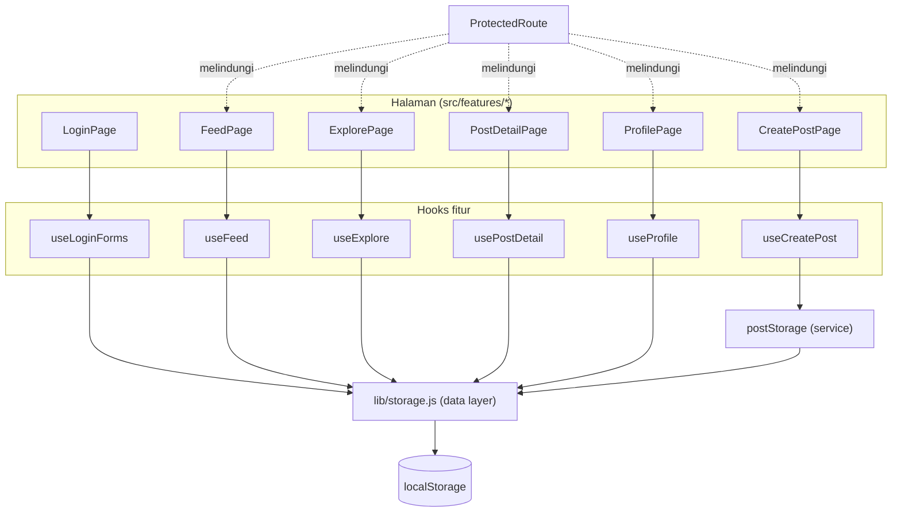
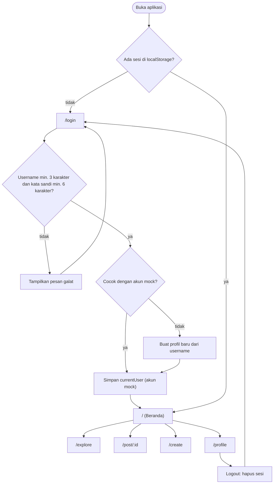
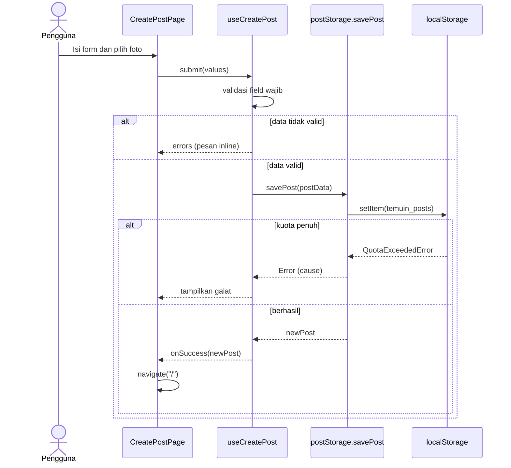
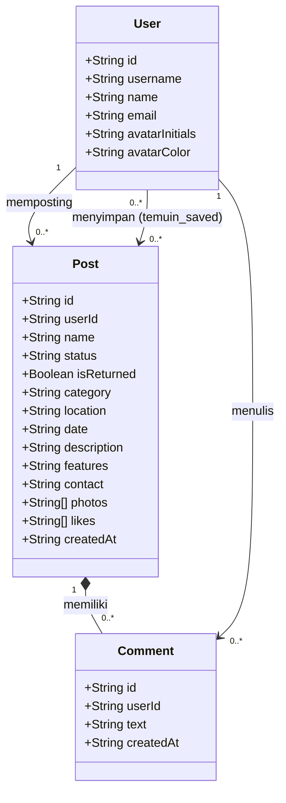
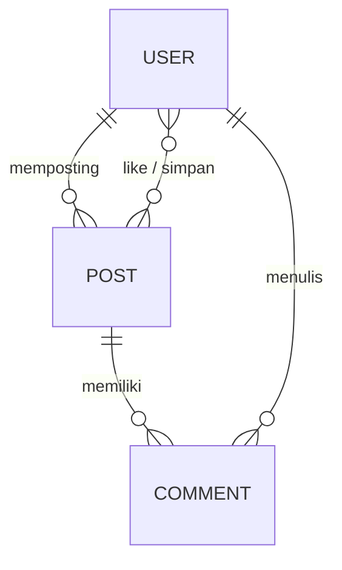

# Diagram Orbit (Lost & Found)

Diagram ditulis dengan [Mermaid](https://mermaid.js.org) dan dirender otomatis
oleh GitHub.

## 1. Diagram komponen (arsitektur berlapis)

## 2. Alur navigasi dan autentikasi

## 3. Diagram urutan: membuat postingan

## 4. Diagram kelas: model data

## 5. Alur data (ERD sederhana)

Kunci `localStorage`: `temuin_currentUser`, `temuin_posts`, `temuin_saved`
(`src/lib/storage.js:15`).
